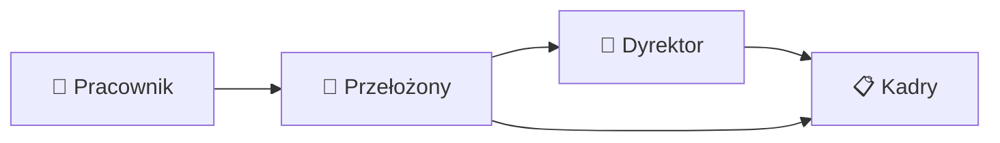

# 🌴 Cer — wnioski urlopowe

Aplikacja **Cer Motor** do składania i akceptacji wniosków urlopowych. Pracownik składa wniosek, przełożony ocenia wpływ na zespół, dyrektor wchodzi przy długim urlopie, a kadry zatwierdzają go formalnie. Limity, święta i struktura firmy biorą się z bazy, a komunikaty zostają w aplikacji.

Obecna wersja to MVP plus urlop na żądanie i odbiór dnia wolnego za pracę w sobotę.

## 🧰 Technologie

| Warstwa | Narzędzie |
| --- | --- |
| ⚛️ Aplikacja | [Next.js](https://nextjs.org/) (App Router), React 19, TypeScript |
| 🎨 Wygląd | styled-components, własny motyw jasny i ciemny |
| 🎞️ Ruch | Motion, mgła powitania (Vanta FOG + Three.js) |
| 🔐 Konta | Supabase Auth, e-mail i hasło, sesja w ciasteczku httpOnly (`@supabase/ssr`) |
| 🗄️ Dane | Supabase Postgres, region EU. Odczyt i zapis tylko po stronie serwera |
| 🚀 Wdrożenie | jeden projekt na Vercel |
| 🧪 Testy | wbudowany runner Node (`node:test`) przez `tsx` |

Przeglądarka nie łączy się z Supabase. Strony czytają dane na serwerze, a formularze wołają własne endpointy `/api`.

## 👥 Role

Każda osoba jest pracownikiem i składa własne wnioski, także wtedy, gdy dodatkowo akceptuje wnioski innych. Jedno konto może łączyć kilka funkcji. Rola nie jest wybierana przy logowaniu.

| Rola | Skąd wynika | Co robi |
| --- | --- | --- |
| 👤 Pracownik | każdy rekord pracownika | tworzy wniosek, wskazuje termin i zastępcę, śledzi status i widzi swoje limity. Przed ostatecznym zatwierdzeniem może wniosek wycofać. Wniosek cofnięty do pracownika da się poprawić i złożyć ponownie |
| 👔 Przełożony | pole `manager_id` w strukturze | dostaje wnioski swojego zespołu. Akceptuje, odrzuca albo cofa do pracownika. Odrzucenie i cofnięcie wymagają komentarza |
| 🏢 Dyrektor | flaga na koncie | wchodzi tylko wtedy, gdy urlop trwa dłużej niż 21 dni kalendarzowych (od dnia rozpoczęcia do zakończenia włącznie). Decyduje po przełożonym, a przed kadrami. Może zaakceptować, odrzucić albo cofnąć do przełożonego |
| 📋 Kadry | flaga na koncie | robią kontrolę formalną i limitu, a potem zatwierdzają wniosek. Mogą odrzucić, cofnąć do pracownika albo cofnąć do przełożonego. Widzą listę urlopów wszystkich pracowników |

## 🔀 Ścieżka akceptacji



Dyrektor wchodzi tylko przy urlopie dłuższym niż 21 dni kalendarzowych. Dokładnie 21 dni idzie od przełożonego prosto do kadr. Osoba bez przełożonego pomija ten krok. Jeśli jedynym dyrektorem jest osoba składająca wniosek, system przekazuje wniosek od razu do kadr. Tego kroku nie da się pominąć ręcznie.

Gdy przełożony ma aktywne zastępstwo, nowe wnioski idą do jego zastępcy.

## ✅ Funkcje

### 🏠 Pulpit i konto

- Logowanie e-mailem i hasłem oraz wylogowanie z menu z imieniem i nazwiskiem.
- Belka powitania od górnej krawędzi ekranu: „Cześć” i imię, liczba nowych zadań, awatar z inicjałami i plakietka „NOWE”. Tło belki to ruchoma mgła.
- Menu przykleja się po przewinięciu. Napis „Wnioski urlopowe” wraca na pulpit.
- Przełącznik jasnego i ciemnego motywu, także na stronie logowania. Wybór zostaje w przeglądarce.
- Kafelki: **Utwórz wniosek urlopowy**, **Moje wnioski urlopowe**, **Moje zadania** (z licznikiem), **Urlopy zespołu** albo **Kalendarz**. Kadry mają dodatkowo **Urlopy pracowników**. Otwarty kafelek jest podświetlony.
- Strona FAQ z opisem ról i kroków wniosku, dostępna z menu użytkownika.
- Pasek „wersja demonstracyjna” na ekranie logowania.

### 📝 Wnioski

Cztery rodzaje:

- 🏖️ **Urlop wypoczynkowy bieżący** — schodzi z puli bieżącego roku.
- 📅 **Urlop wypoczynkowy zaległy** — system zużywa najstarszy rok. Nie wymusza kolejności „najpierw zaległy”.
- ⚡ **Urlop na żądanie** — do 4 dni w roku kalendarzowym, schodzi z puli bieżącej. Da się go złożyć w dniu rozpoczęcia.
- 🛠️ **Odbiór dnia wolnego za pracę w sobotę** — jeden dzień wolny i data, w której wykonywano pracę. Ten dzień musi być sobotą, niedzielą albo świętem.

Na formularzu:

- termin z polami daty, lista zastępców, podgląd dni roboczych i kalendarzowych,
- zapis wersji roboczej albo od razu przekazanie do akceptacji,
- ostrzeżenie, gdy wniosek jest składany w dniu rozpoczęcia albo później (urlop na żądanie tego ostrzeżenia nie pokazuje),
- informacja, że urlop powyżej 21 dni kalendarzowych pójdzie do dyrektora,
- blokada, gdy brakuje limitu albo wskazany zastępca jest w tym terminie nieobecny.

Wniosek jest zawsze na cały dzień. Dni urlopu liczą się bez sobót, niedziel i świąt z jednego kalendarza firmy. Wymiar etatu jest zapisany przy pracowniku i nie przelicza puli.

### 📊 Limity, zespół i kalendarz

- Pulpit pokazuje wymiar, wykorzystanie, plan i pozostało: urlop bieżący, zaległe lata i urlop na żądanie.
- Dla osób z zespołem: kto jest nieobecny dzisiaj, najbliższe 30 dni, nakładające się nieobecności i aktywne zastępstwa akceptujących.
- Kolizja w zespole jest ostrzeżeniem przy akceptacji. Sama nie zatrzymuje wniosku.
- Kalendarz miesiąca z listą osób na dany dzień i przejściem do poprzedniego oraz następnego miesiąca.
- Kadry widzą tabelę pracowników: dział oraz pozostały urlop bieżący, na żądanie i zaległy.
- Brak limitu blokuje złożenie. Źródłem prawdy jest limit zapisany w bazie (seed).

### ✔️ Akceptacja i statusy

Statusy: roboczy, oczekuje na przełożonego, oczekuje na dyrektora, oczekuje na kadry, zaakceptowany, odrzucony, cofnięty do pracownika, wycofany.

- Przełożony może przy decyzji zmienić zastępcę i dodać komentarz.
- Odrzucenie i cofnięcie wymagają komentarza. Akceptacja komentarza nie wymaga.
- Autor wycofuje wniosek do momentu ostatecznego zatwierdzenia przez kadry.
- Po akceptacji kadr wniosek ma status „Zaakceptowany” i pojawia się w kalendarzu.
- Każdy krok zostawia wpis w historii: kto, jaka czynność i komentarz.
- Widok wniosku pokazuje numer, wnioskującego, stanowisko, dział, lokalizację, rodzaj, termin, dni robocze i kalendarzowe oraz rozbicie zaległego na lata.

### 🔔 Powiadomienia

Komunikaty są tylko w aplikacji. Pulpit pokazuje ostatnie, a liczba zadań na belce liczy wnioski czekające na decyzję zalogowanej osoby.

## 🚀 Uruchomienie

```bash
npm install
npm run dev
```

Aplikacja startuje pod adresem z komunikatu Next.js (zwykle `http://localhost:3000`).

W pliku `.env` (nie trafia do repozytorium) potrzebne są:

- `SUPABASE_URL`
- `SUPABASE_PUBLISHABLE_KEY` albo `SUPABASE_ANON_KEY`
- `SUPABASE_SECRET_KEY` albo `SUPABASE_SERVICE_ROLE_KEY`
- `SEED_PASSWORD` — hasło kont demonstracyjnych, co najmniej 8 znaków

Konta, działy, lokalizacje, limity, święta i przykładowa struktura:

```bash
npm run seed
```

Seed zakłada m.in. dyrektorkę Ewę Nowak, kadry (Marek Kadry), kierownika Roberta Wiśniewskiego i specjalistkę Annę Kowalską. Hasło jest wspólne i pochodzi z `SEED_PASSWORD`.

Produkcyjny build:

```bash
npm run build
npm start
```

## 🧪 Testy

```bash
npm test
```

Sprawdzane są daty i dni robocze, limity (w tym urlop na żądanie i najstarszy rok zaległy) oraz przejścia statusów na ścieżce akceptacji.

## 🗺️ Ekrany

| Adres | Ekran |
| --- | --- |
| `/login` | Logowanie |
| `/` | Pulpit: limity, zespół, zadania, komunikaty |
| `/wnioski/nowy` | Nowy wniosek |
| `/wnioski` | Moje wnioski |
| `/wnioski/[id]` | Szczegóły, edycja, decyzja, wycofanie, historia |
| `/zadania` | Wnioski czekające na moją decyzję |
| `/kalendarz` | Kalendarz nieobecności |
| `/pracownicy` | Limity pracowników (kadry) |
| `/faq` | Role i przebieg wniosku |
