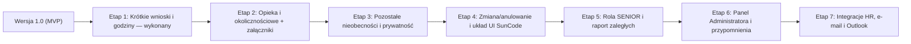

# Plan rozwoju systemu CerMotor — wnioski urlopowe

Data: 2026-11-03.

Dokument opisuje drogę od wersji 1.0 (MVP) do pełnej specyfikacji w `docs/specyfikacja_procesu_urlopy_20261103.md`. Funkcjonalności wchodzą etapami, po trzy na raz. Ten plik jest planem pracy. Samo jego zapisanie nie wdraża kolejnych etapów.

Etap 1 został wykonany 2026-11-03: kod jest w repozytorium, a migracja `supabase/migrations/20261103150000_stage1_short_leaves_and_hours.sql` została uruchomiona w Supabase. Wygląd jasnego pulpitu, z belką powitania, został przyjęty 2026-11-04. Kolejny etap uruchamia się osobno, na przykład poleceniem: „Wdróż Etap 2 z planu".

## Stan bazowy (wersja 1.0 MVP — gotowa)

Obecna wersja produkcyjna obsługuje:

- Role: pracownik, przełożony (`manager_id`), dyrektor (`is_director`), kadry (`is_hr`).
- Wnioski: urlop wypoczynkowy bieżący (`current`) oraz zaległy (`overdue`, najstarszy rok pierwszy).
- Ścieżkę akceptacji: pracownik → przełożony → dyrektor (gdy więcej niż 21 dni kalendarzowych) → kadry, z wycofaniem przed zatwierdzeniem.
- Zastępstwa osób wnioskujących i akceptujących, kalendarz dni roboczych ze świętami z tabeli `public_holidays`, ostrzeżenia o kolizjach w zespole oraz powiadomienia wewnątrz aplikacji.

## Wygląd pulpitu — przyjęty 2026-11-04

Jasny pulpit jest przyjęty. Nie wracać do zielonego gradientu powitania ani do pomarańczowej belki ze zrzutów SunCode. Ciemny motyw, przyjęty 2026-11-04, ma szare tło `#1C1C1C` i karty `#262626`. Seledyn `#57A49E` jest obwódką, linkiem i ikoną. Aktywny kafelek bierze `#2A6B71`.

Belka powitania (`Welcome` w `components/ui.tsx`, mgła w `components/WelcomeFog.tsx`) zostaje w tej postaci:

- Zaczyna się od górnej krawędzi ekranu, na pełną szerokość, z zaokrąglonym dołem.
- Tło to ruchoma mgła (Vanta FOG, `speed` 2, pakiety `three` i `vanta`). Barwy są w `theme.hero`.
- Treść: „Cześć” i imię, liczba zadań do wykonania, awatar z inicjałami. Awatar i plakietka „NOWE” mają kolor `theme.mark` (`#D92D59`).

Menu (`TopBar` w `components/AppShell.tsx`):

- Leży na belce. Na górze strony jest przezroczyste, napisy są jasne. Po przewinięciu zostaje przyklejone i dostaje mlecznobiałe tło.
- Po lewej logo CerMotor bez białej płytki i cienia oraz napis „Wnioski urlopowe”.
- Po prawej przełącznik motywu i menu z imieniem i nazwiskiem. „Wyloguj” ma ten sam rozmiar co przycisk z imieniem: szkło, gdy leży na belce powitania, białe tło po przewinięciu.

Reszta jasnego pulpitu: strona `#F8FAFC`, karty białe z obwódką `#2563EB`, kafelki jak białe przyciski. Komunikaty i przyciski sukcesu używają zieleni `#16A34A`, ostrzeżenia i błędy pomarańczu `#EA580C`. Treść pod kafelkami zmienia się krótką animacją w `components/PageTransition.tsx`.

## Kolejność etapów

## Etap 1: Wnioski krótkoterminowe, wymiar godzinowy i odbiór za sobotę — wykonany

**Status: wykonany (2026-11-03).** Urlop na żądanie, odbiór dnia wolnego za pracę w sobotę i niepełny dzień w godzinach są w kodzie. Migracja jest wykonana w Supabase.

Sekcje specyfikacji: 3, 4, 6, 9, 11, wygląd formularza.

1. **Urlop na żądanie (sekcja 9)**
   - Dodanie typu `on_demand` do modelu wniosków (`docs/db.md`, migracja SQL, `lib/leave/workflow.ts`).
   - Kontrola rocznego podlimitu (4 dni w roku kalendarzowym) schodzącego z puli urlopu wypoczynkowego bieżącego (`lib/leave/limits.ts`).
   - Pominięcie ostrzeżenia o zbyt krótkim terminie złożenia (możliwość złożenia w dniu rozpoczęcia).
2. **Odbiór dnia wolnego za pracę w sobotę / dzień wolny (sekcja 11)**
   - Dodanie typu `saturday_comp` oraz pola `worked_date` (dzień, w którym wykonywano pracę) w `leave_requests`.
   - Dynamiczna sekcja w `components/LeaveForm.tsx` pokazująca kalendarz dnia przepracowanego i proponowanego dnia wolnego.
3. **Nieobecności w wymiarze godzinowym / niepełny dzień (sekcje 6, 9, 10, wygląd formularza)**
   - Rozbudowa `leave_requests` o pola `full_day` (boolean), `time_from`, `time_to`, `planned_hours` (numeric).
   - Godziny w danych zostają. Formularz zawsze zapisuje cały dzień, bo urlop jest co najmniej jednodniowy. Przełącznika „Cały dzień” nie ma.

## Etap 2: Wnioski rodzinne, okolicznościowe, bezpłatne oraz obsługa załączników

Sekcje specyfikacji: 4, 10, 12, 13, 14, 38.

1. **Urlop / zwolnienie na dziecko (art. 188 KP) oraz urlop opiekuńczy z oświadczeniem (sekcje 10, 13)**
   - Dodanie typów `childcare` (2 dni / 16 h w roku) oraz `care_leave` (5 dni urlopu opiekuńczego).
   - Nowa tabela `leave_declarations` (lub kolumny audytowe na wniosku) zapisująca treść oświadczenia drugiego rodzica, dane dziecka / osoby wymagającej opieki oraz czas złożenia oświadczenia.
   - Twarda blokada złożenia wniosku bez zaznaczenia wymaganego oświadczenia (`lib/leave/service.ts`).
2. **Urlop okolicznościowy i urlop bezpłatny (sekcje 12, 14)**
   - Dodanie typów `compassionate` (ze słownikiem powodów i stopniem pokrewieństwa: 1 lub 2 dni) oraz `unpaid` (z obowiązkowym polem uzasadnienia).
3. **Obsługa załączników w Supabase Storage (sekcje 2.1, 12, 14, 21, 38)**
   - Prywatny bucket w Supabase Storage oraz tabela metadanych `leave_attachments` (`request_id`, `file_name`, `storage_path`, `uploaded_by`).
   - Pliki nie trafiają na dysk serwera. Przesyłanie i pobieranie idzie przez podpisane adresy generowane na serwerze w `lib/db/`.
   - Blokada złożenia wniosku, gdy dany rodzaj nieobecności wymaga obowiązkowego załącznika.

## Etap 3: Pełny katalog 14 nieobecności, ochrona danych wrażliwych i rozdział blokad od ostrzeżeń

Sekcje specyfikacji: 3, 20, 32, 38, 39.

1. **Pozostałe rodzaje nieobecności (pozycje 9–14 z sekcji 3)**
   - Dodanie typów: `paternity` (ojcowski), `parental` (rodzicielski), `maternity` (macierzyński), `upbringing` (wychowawczy), `other_excused` (inna usprawiedliwiona, płatna albo bezpłatna), `other_hr` (inny rodzaj do obsługi przez kadry, w tym oddanie krwi).
   - Dynamiczny formularz w `components/LeaveForm.tsx` dopasowujący pola do każdego z 14 typów.
2. **Ochrona danych wrażliwych i widoczność przyczyny nieobecności (sekcje 20, 39)**
   - Maskowanie wrażliwych szczegółów (załączników, danych członków rodziny, uzasadnień zdrowotnych i opiekuńczych) w kalendarzu zespołu (`app/(app)/kalendarz/page.tsx`) i dla ról nieuprawnionych.
   - Pełny wgląd dla wnioskującego i kadr (`is_hr`). Dla przełożonego tylko zakres potrzebny do organizacji pracy i weryfikacji wymiaru (na przykład przy okolicznościowym).
3. **Kontrola terminów: ostrzeżenia osobno od twardych blokad (sekcje 7, 32, 38)**
   - Ostrzeżenia nieblokujące: zbyt późne złożenie wniosku, zbliżający się termin wykorzystania urlopu zaległego do 30 września, przekroczenie 3 tygodni, kolizje w zespole.
   - Możliwość przekazania wniosku przekraczającego limit do specjalnej obsługi albo korekty przez kadry (sekcje 7 i 8).

## Etap 4: Zmiana i anulowanie zatwierdzonego urlopu oraz układ ekranu według wzorca SunCode

Sekcje specyfikacji: 27, 29, wygląd strony (pulpit i formularz).

1. **Zmiana albo anulowanie zatwierdzonego urlopu (sekcje 27, 29)**
   - Pole `parent_request_id` oraz rodzaj operacji (`change` / `cancel`) w `leave_requests`, a także status `anulowany`.
   - Przycisk „Złóż wniosek o zmianę / anulowanie nieobecności" na widoku zaakceptowanego wniosku (`app/(app)/wnioski/[id]/page.tsx`).
   - Pełna historia pierwotnego wniosku oraz przeliczenie puli limitu po ostatecznej akceptacji anulowania albo zmiany.
2. **Listy pulpitu, bez zmiany przyjętej belki**
   - Belka powitania, menu i kolory jasnego pulpitu są przyjęte (sekcja „Wygląd pulpitu — przyjęty 2026-11-04”). Nie zastępować ich układem pomarańczowym ze zrzutów.
   - Do dodania, gdy wejdą załączniki i zastępstwa jako osobne widoki: kafelki „Moje zastępstwa”, „Moje przyszłe zastępstwa” oraz „Załączniki”.
   - Paginacja z tekstem „Wyświetlono X–Y z Z” tam, gdzie lista jest dłuższa niż jedna strona. Plakietka „NOWE” już jest.
3. **Formularz wniosku według sekcji „Wygląd strony"**
   - Sekcja „Dane wniosku" tylko do odczytu (identyfikator, data wniosku, wnioskujący) na górze formularza.
   - Panel „Dostępne dni urlopowe", wyszukiwarka zastępcy po imieniu i nazwisku oraz przycisk „Dodaj nowy komentarz" z poziomu formularza.

## Etap 5: Rola SENIOR, raport urlopów zaległych i zaawansowany kalendarz

Sekcje specyfikacji: 2.5, 19, 24, 33, 37.

1. **Rola SENIOR i pulpit zarządu (sekcje 2.5, 24, 37)**
   - Flaga `is_senior` w tabeli `employees` (`docs/db.md`, `lib/types.ts`).
   - Widok `/senior` (albo rozszerzenie pulpitu i `/pracownicy`) ze statystykami całej firmy: liczba pracowników, obecni i nieobecni dzisiaj, wnioski według statusów, wykorzystanie urlopów oraz karta wybranego pracownika.
2. **Monitoring i raport urlopów zaległych (sekcja 33)**
   - Widok raportowy dla kadr (`is_hr`) i zarządu (`is_senior`): pracownik, rok, pozostało, termin graniczny (30.09), status.
   - Wskazanie pracowników z niewykorzystanym urlopem zaległym.
3. **Filtrowanie kalendarza i wniosków (sekcje 19, 24)**
   - Filtrowanie w `app/(app)/kalendarz/page.tsx` oraz na listach wniosków według: pracownika, działu, lokalizacji, stanowiska, przełożonego, rodzaju nieobecności, statusu i zakresu dat.

## Etap 6: Panel administratora oraz automatyczne przypomnienia (24 h / 48 h)

Sekcje specyfikacji: 2.6, 8, 12, 17, 31, 37.

1. **Administrator — pracownicy, struktura i uprawnienia (sekcje 2.6, 37)**
   - Flaga `is_admin` w tabeli `employees`.
   - Widok `/admin` do zarządzania działami, lokalizacjami, pracownikami, przypisaniem przełożonych (`manager_id`) oraz rolami (`is_director`, `is_hr`, `is_senior`, `is_admin`).
2. **Administrator i kadry — limity, zastępstwa akceptujących i słowniki (sekcje 8, 12, 17)**
   - Roczne limity urlopowe (`leave_balances`) oraz ręczna korekta w szczególnych sytuacjach przez kadry (sekcja 8).
   - Zastępstwa przełożonych (`approver_substitutions`), kalendarz świąt (`public_holidays`) i parametry procesu.
3. **Automatyczne przypomnienia 24 h i 48 h (sekcja 31)**
   - Endpoint cykliczny `/api/cron/reminders` (Vercel Cron) dla wniosków oczekujących na decyzję dłużej niż ustawiony próg.
   - Przypomnienia dla przełożonych, dyrektorów i kadr bez powtarzania już wysłanego alertu.

## Etap 7: Integracje zewnętrzne (system HR, kalendarz firmowy, e-mail)

Sekcje specyfikacji: 6, 30, 34, 35.

1. **Integracja z systemem kadrowo-płacowym (sekcja 34)**
   - `HR → Workflow`: import i aktualizacja pracowników, struktury, wymiaru etatu, kalendarzy pracy i limitów.
   - `Workflow → HR`: eksport zatwierdzonych nieobecności (rodzaj, okres, dni robocze albo godziny) do ewidencji czasu pracy.
2. **Integracja z kalendarzem firmowym Microsoft 365 / Outlook (sekcja 35)**
   - Wpis kalendarzowy (plik iCalendar `.ics` oraz opcjonalny konektor Microsoft Graph) po statusie `zaakceptowany`.
   - Usunięcie albo aktualizacja wpisu po anulowaniu lub zmianie urlopu.
3. **Powiadomienia e-mail (sekcje 30, 31)**
   - Wysyłka wiadomości e-mail równolegle do komunikatów w aplikacji przy zmianie statusu wniosku oraz przy przypomnieniach 24 h / 48 h.

## Po zakończeniu etapu 7

Projekt obejmuje wszystkie funkcjonalności opisane w `docs/specyfikacja_procesu_urlopy_20261103.md`: pełny katalog nieobecności, załączniki, zmianę i anulowanie zatwierdzonego wniosku, rolę SENIOR, panel administratora, przypomnienia, raporty, ochronę danych wrażliwych oraz integracje z HR, pocztą i kalendarzem firmowym.
