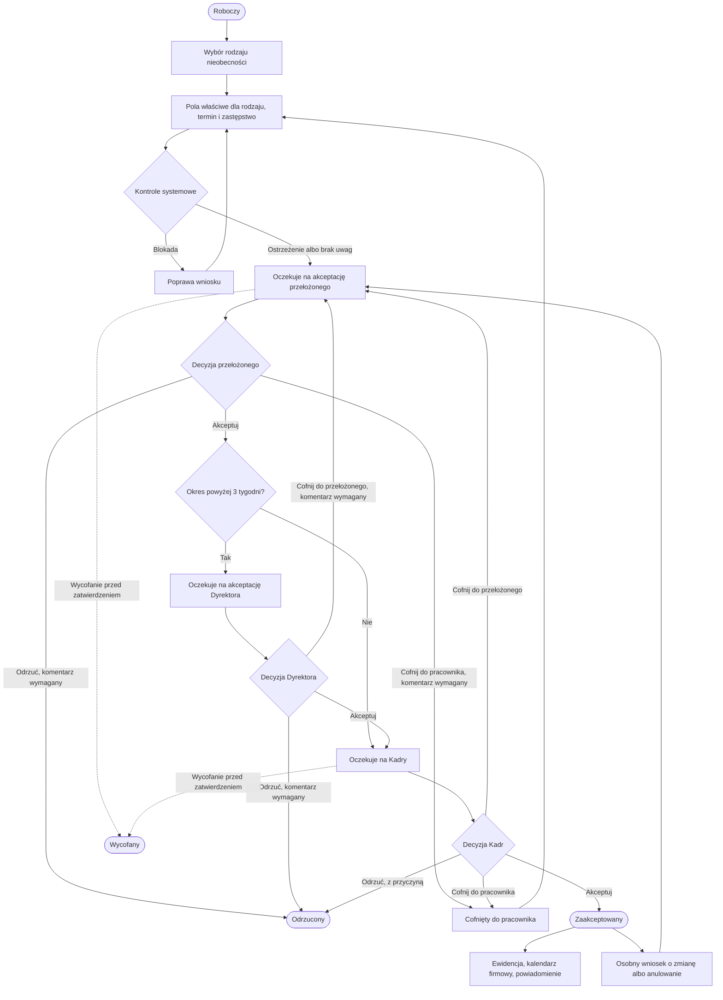

# Specyfikacja biznesowa — proces wniosków urlopowych i nieobecności

**Cer Motor Sp. z o.o.**

Dokument roboczy projektu Cer — wnioski urlopowe. Przepisany ze źródła `SPECYFIKACJA BIZNESOWA PROCESU SUNCODE_Urlopy.docx`. Komentarze recenzentów są oznaczone przy fragmencie, którego dotyczą. Nie zastępują treści specyfikacji, dopóki nie zostaną przyjęte.

Proces jest systemem obsługi nieobecności, a nie wyłącznie elektronicznym formularzem urlopowym.

Układ i kolory strony są w sekcji „Wygląd strony”. Źródło: `example1.png`, `example2.png`, `example3.png`.

## Przebieg procesu

Standardowa akceptacja: Pracownik → Przełożony → Kadry. Gdy nieobecność trwa powyżej 3 tygodni: Pracownik → Przełożony → Dyrektor → Kadry. Użytkownik nie może ręcznie pominąć akceptacji Dyrektora. Długość nieobecności liczy system.

Gdy osoba akceptująca ma aktywne zastępstwo, nowe wnioski trafiają do zastępcy bez ręcznego przekazywania zadań. Kolizja nieobecności w zespole jest ostrzeżeniem: nie odrzuca wniosku sama. Decyzja należy do przełożonego.

## 1. Cel projektu

Celem jest wdrożenie w systemie SunCode Workflow jednolitego, elektronicznego procesu składania, akceptacji, ewidencjonowania i monitorowania wniosków dotyczących urlopów oraz innych nieobecności.

System zastępuje papierowe i mailowe składanie wniosków oraz zapewnia:

- jeden standard składania wniosków dla wszystkich pracowników,
- automatyczne kierowanie wniosku do właściwych osób,
- kontrolę dostępnych limitów,
- kontrolę terminów i dni roboczych,
- obsługę zastępstw,
- kontrolę kolizji nieobecności,
- pełną historię procesu i decyzji,
- automatyczne powiadomienia,
- dostęp do kalendarza nieobecności,
- raportowanie,
- nadzór Kadry Senior Management.

## 2. Uczestnicy procesu i role

### 2.1. Pracownik

Może:

- złożyć wniosek,
- wybrać rodzaj nieobecności,
- wskazać termin,
- wskazać zastępstwo,
- dodać wymagane informacje i załączniki,
- śledzić status wniosku,
- wycofać wniosek w zakresie dopuszczonym przez proces,
- przeglądać historię swoich wniosków,
- przeglądać swoje wykorzystane i pozostałe limity.

### 2.2. Bezpośredni przełożony — I stopień akceptacji

Odpowiada za:

- ocenę zasadności terminu,
- ocenę wpływu nieobecności na funkcjonowanie zespołu,
- akceptację lub odrzucenie wniosku,
- weryfikację zastępstwa,
- możliwość wskazania innego zastępstwa,
- zgłoszenie uwag lub cofnięcie wniosku do pracownika.

### 2.3. Dyrektor — dodatkowy poziom akceptacji

Dyrektor uczestniczy w przypadkach określonych w tej specyfikacji, w szczególności przy nieobecności dłuższej niż 3 tygodnie. Wniosek dostaje po akceptacji bezpośredniego przełożonego, a przed przekazaniem do Kadr.

Docelowo system umożliwia skonfigurowanie innych przypadków wymagających akceptacji Dyrektora.

### 2.4. Kadry — II stopień, kontrola formalna

Kadry odpowiadają za:

- kontrolę formalną wniosku,
- kontrolę uprawnienia i limitu,
- weryfikację dokumentów,
- kontrolę zgodności z ewidencją czasu pracy,
- zatwierdzenie wniosku od strony kadrowej,
- obsługę wyjątków,
- prowadzenie ewidencji.

Kadry nie podejmują ponownie decyzji o organizacji pracy zespołu, jeżeli właściwy przełożony ją zaakceptował. Mają możliwość cofnięcia wniosku do przełożonego z komentarzem.

> **Komentarz (Kamila Babula, 2026-08-18), przy kontroli formalnej:** Kadry potrzebują wszystkich danych wniosku, żeby ocenić, czy świadczenie się należy i w jakiej ilości. Dotyczy to w szczególności urlopu okolicznościowego i nieobecności usprawiedliwionych.

> **Komentarz (Kamila Babula, 2026-08-18), przy oświadczeniach:** Kadry potrzebują dostępu w szczególności do anulowanych wniosków urlopowych, żeby nie powstała sytuacja, w której pracownik nie wykorzysta dwutygodniowego urlopu, bo anulował go po sprawdzeniu, że wniosek był wypisany i zatwierdzony.

### 2.5. SENIOR — Zarząd, najwyższy poziom wglądu

Rola dla Prezesa oraz Członka Zarządu albo wskazanej osoby zarządzającej.

SENIOR ma pełny, nieograniczony wgląd w procesy urlopowe i nieobecności wszystkich pracowników. Może:

- przeglądać wszystkich pracowników, wszystkie wnioski i statusy,
- przeglądać kalendarz nieobecności całej firmy,
- filtrować według działu, lokalizacji, pracownika, przełożonego, rodzaju nieobecności i statusu,
- przeglądać wykorzystanie urlopów, zaległe urlopy, aktualne nieobecności i planowane nieobecności.

Rola SENIOR nie oznacza automatycznej akceptacji każdego wniosku. To rola nadzorcza i raportowa, chyba że dla określonych kategorii zostanie później ustalona dodatkowa ścieżka akceptacji.

### Administrator

Konfiguracja procesu i uprawnień. Rola opisana w sekcji uprawnień.

## 3. Rodzaje wniosków

Po wybraniu „Nowy wniosek o nieobecność” pracownik dostaje listę:

1. Urlop wypoczynkowy — bieżący
2. Urlop wypoczynkowy — zaległy
3. Urlop na żądanie
4. Odbiór dnia wolnego za pracę w sobotę / dzień wolny
5. Urlop / zwolnienie na dziecko — art. 188 KP
6. Urlop opiekuńczy
7. Urlop okolicznościowy
8. Urlop bezpłatny
9. Urlop ojcowski
10. Urlop rodzicielski
11. Urlop macierzyński
12. Urlop wychowawczy
13. Inna usprawiedliwiona nieobecność
14. Inny rodzaj nieobecności — do obsługi przez Kadry; tu wpisano oddanie krwi i możliwość listy rozwijanej

Lista może zostać rozszerzona o kolejne typy bez przebudowy całego procesu.

> **Komentarz (Kamila Babula, 2026-08-18), przy rodzajach wniosków:** W pierwszej kolejności należy wykorzystać urlop zaległy, a dopiero potem bieżący. Kodeks pracy nie wskazuje tej kolejności wprost w art. 168. Takie stanowisko potwierdza orzecznictwo Sądu Najwyższego oraz wytyczne Państwowej Inspekcji Pracy.

> **Komentarz (Kamila Babula, 2026-08-18), przy urlopie rodzicielskim:** Urlop macierzyński i rodzicielski trzeba rozdzielić. Macierzyński jest obowiązkowym, 20-tygodniowym świadczeniem dla matki tuż po porodzie. Rodzicielski jest dobrowolnym, dodatkowym, 41-tygodniowym okresem opieki, który mogą dzielić oboje rodzice.

> **Komentarz (Kamila Babula, 2026-08-18), przy innej usprawiedliwionej nieobecności:** Dodać pytanie, w jakim celu jest nieobecność. Są nieobecności usprawiedliwione płatne i bezpłatne, na przykład powołanie na świadka (bezpłatna, dokument o utraconym zarobku) albo udział w komisji wyborczej (1 lub 2 dni wolnego płatnego). Takich rodzajów jest dużo.

> **Komentarz (Kamila Babula, 2026-08-18), przy innym rodzaju:** Dodać oddanie krwi jako częsty rodzaj nieobecności. W treści źródła oddanie krwi jest już wpisane przy pozycji „inny rodzaj”.

## 4. Zasada dynamicznego formularza

Formularz nie jest identyczny dla wszystkich rodzajów nieobecności. Po wyborze rodzaju system pokazuje tylko pola właściwe dla tego rodzaju.

Dla zwykłego urlopu wypoczynkowego pracownik podaje przede wszystkim:

- datę od,
- datę do,
- zastępstwo.

Dla urlopu bezpłatnego dodatkowo:

- uzasadnienie,
- ewentualne dodatkowe informacje.

Dla urlopu na dziecko dodatkowo:

- odpowiednie oświadczenie,
- sposób wykorzystania uprawnienia,
- wymagane dane dotyczące drugiego rodzica.

> **Komentarz (Michał Olszewski, 2026-08-21), przy decyzji o dynamicznym formularzu:** Zamiast jednego dynamicznego formularza — wiele odrębnych formularzy, po jednym dla każdego rodzaju nieobecności. To jest w sprzeczności z tą sekcją i z punktem decyzji w sekcji 43. Do rozstrzygnięcia.

## 5. Dane pracownika

Dane pracownika są pobierane automatycznie ze systemu źródłowego / HR i nie są wpisywane ręcznie. System zna co najmniej:

- imię i nazwisko,
- numer pracownika,
- dział,
- stanowisko,
- lokalizację,
- przełożonego,
- strukturę organizacyjną,
- wymiar etatu,
- odpowiedni kalendarz pracy,
- dostępne limity urlopowe,
- wykorzystane limity,
- urlopy zaplanowane,
- informacje niezbędne do prawidłowego wyliczenia uprawnień.

## 6. Wybór terminu

Pracownik wybiera:

- data rozpoczęcia — kalendarz,
- data zakończenia — kalendarz.

System liczy liczbę dni roboczych. Uwzględnia:

- soboty,
- niedziele,
- święta,
- dni wolne wynikające z kalendarza,
- indywidualny wymiar czasu pracy,
- ewentualne niestandardowe harmonogramy pracy.

Przykład prezentacji:

- Termin: 10.08.2026 – 14.08.2026
- Liczba dni urlopu: 5 dni roboczych

## 7. Urlop wypoczynkowy — bieżący

Po wybraniu „Urlop wypoczynkowy” system pokazuje:

- dostępny limit,
- wykorzystany limit,
- zaplanowany urlop,
- pozostały limit.

Przykład: limit roczny 26 dni, wykorzystano 12 dni, zaplanowano 5 dni, pozostało 9 dni.

Po wyborze terminu system sprawdza, czy pracownik ma wystarczający limit. Gdy nie ma, pokazuje ostrzeżenie: „UWAGA: wybrany termin przekracza dostępny limit urlopu.”

Wniosek zostaje zablokowany albo przekazany do specjalnej obsługi przez Kadry. Decyzja techniczna ma zapaść na kolejnym etapie.

## 8. Urlop zaległy

Urlop zaległy jest osobną kategorią. Pracownik widzi podział, na przykład:

- 2025: 6 dni
- 2024: 0 dni

W źródle jest zapisana rezygnacja z wyboru roku przez pracownika: **zawsze system zabiera najstarszy urlop.**

System kontroluje:

- dostępny limit,
- rok pochodzenia urlopu,
- wykorzystanie urlopu zaległego,
- termin wymagany przepisami prawa.

Kadry mogą ręcznie skorygować szczególną sytuację.

> **Komentarz (Kamila Babula, 2026-08-18), przy wskazywaniu roku:** Ta sama zasada kolejności co przy rodzajach wniosków: najpierw urlop zaległy, potem bieżący.

## 9. Urlop na żądanie

Osobna ścieżka i osobny formularz:

- data — kalendarz,
- liczba godzin / dzień — zgodnie z zasadami obowiązującymi pracownika.

System kontroluje dostępny limit urlopu na żądanie. Nie stosuje standardowej reguły minimalnego wyprzedzenia. Wniosek można złożyć także w dniu rozpoczęcia nieobecności.

> **Komentarz (Kamila Babula, 2026-08-18):** Urlop na żądanie jest częścią urlopu wypoczynkowego. Przykład: 20 dni, w tym 4 na żądanie. Ma schodzić z wypoczynkowego. Gdy wypoczynkowego już nie ma, urlopu na żądanie nie można wziąć i zostaje urlop bezpłatny.

> **Komentarz (Marek Rosłan, 2026-08-20):** Uwzględnić limit 4 dni rocznie oraz to, że urlop na żądanie musi mieścić się w wymiarze urlopu wypoczynkowego.

> **Komentarz (Kamila Babula, 2026-08-18), przy dniu rozpoczęcia:** Dodać warunek „najpóźniej o godzinie rozpoczęcia pracy”.

## 10. Urlop / zwolnienie na dziecko

W tytule źródła jest polecenie: rozdzielić urlop od zwolnienia.

System umożliwia określenie:

- dziecka,
- roku wykorzystania,
- liczby dni albo godzin,
- sposobu wykorzystania uprawnienia.

### Obowiązkowe oświadczenie

Pracownik potwierdza oświadczenie o korzystaniu z uprawnienia przez drugiego rodzica. Przykładowa treść:

> Oświadczam, że korzystam z uprawnienia do zwolnienia od pracy z tytułu opieki nad dzieckiem w zakresie wskazanym we wniosku oraz że drugi rodzic/opiekun dziecka nie będzie korzystał z tego uprawnienia w zakresie objętym niniejszym wnioskiem.

Bez zaznaczenia potwierdzenia wniosek nie wychodzi. System zachowuje: kto złożył oświadczenie, kiedy, dla jakiego uprawnienia i w jakim roku.

Treść oświadczenia mają ostatecznie zweryfikować Kadry pod kątem przepisów i polityki firmy.

> **Komentarz (Kamila Babula, 2026-08-18), przy rozdzieleniu:** Urlop i zwolnienie na dziecko nie mogą być razem. Zwolnienie na dziecko wymaga zwolnienia lekarskiego, którego pracownik sam nie wystawia. Jest inaczej płatne, z innej puli, z innymi dokumentami i inną liczbą dni.

> **Komentarz (Kamila Babula, 2026-08-18), przy sposobie wykorzystania:** O sposób wykorzystania pytamy tylko przy urlopie opiekuńczym płatnym w 50%.

> **Komentarz (Kamila Babula, 2026-08-18), przy oświadczeniu:** Chodzi o liczbę dni, nie o konkretny dzień kalendarzowy. Na dwoje rodziców przypadają 2 dni. Gdy jeden rodzic wykorzysta 1 dzień, oświadcza, że drugi tego dnia nie wykorzysta, i w puli zostaje 1 dzień. Ma to być wyraźnie zaznaczone.

## 11. Odbiór dnia wolnego za pracę w sobotę

Formularz:

- dzień, w którym pracownik wykonywał pracę — kalendarz,
- proponowany dzień wolny — kalendarz,
- liczba godzin — automatycznie albo ręcznie.

Jeżeli integracja z ewidencją czasu pracy jest możliwa, system sprawdza, czy wskazana praca została zarejestrowana.

## 12. Urlop okolicznościowy

Pracownik wybiera powód z listy. System stosuje wymiar wynikający z przepisów i konfiguracji firmy. Powody są konfigurowalne.

W zależności od zdarzenia system może wymagać:

- załącznika,
- dokumentu potwierdzającego,
- dodatkowych informacji.

> **Komentarz (Kamila Babula, 2026-08-18):** Dokument potwierdzający jest obowiązkowy niezależnie od okoliczności. Żeby urlop był okolicznościowy, okoliczność musi być wykazana. ZUS tego wymaga.

> **Komentarz (Kamila Babula, 2026-08-18):** Dodać stopień pokrewieństwa. Inna liczba dni przysługuje na przykład przy własnym ślubie, ślubie dziecka, zgonie rodzica oraz zgonie babci albo dziadka.

## 13. Urlop opiekuńczy

Formularz zawiera:

- termin,
- liczbę dni,
- informacje dotyczące osoby wymagającej opieki albo pomocy,
- wymagane oświadczenia.

System kontroluje dostępny limit.

## 14. Urlop bezpłatny

Formularz:

- data od,
- data do,
- liczba dni,
- uzasadnienie albo dodatkowa informacja,
- załącznik, jeżeli jest wymagany.

Ścieżka: Pracownik → Przełożony → Kadry. Powyżej 3 tygodni: Pracownik → Przełożony → Dyrektor → Kadry.

## 15. Dodatkowa akceptacja Dyrektora powyżej 3 tygodni

To jedna z podstawowych reguł procesu. Jeżeli okres nieobecności przekracza 3 tygodnie, po akceptacji bezpośredniego przełożonego wniosek automatycznie trafia do Dyrektora.

Ścieżka standardowa: Pracownik → Przełożony → Kadry → Zatwierdzony.

Powyżej 3 tygodni: Pracownik → Przełożony → Dyrektor → Kadry → Zatwierdzony.

System sam wylicza długość nieobecności. Użytkownik nie może ręcznie ominąć dodatkowego poziomu.

## 16. Zastępstwo

Każdy wniosek, dla którego zastępstwo ma zastosowanie, umożliwia wskazanie osoby zastępującej z listy pracowników.

System sprawdza, czy wskazana osoba:

- jest aktywnym pracownikiem,
- nie przebywa w tym samym okresie na urlopie,
- nie ma innej znanej nieobecności kolidującej z zastępstwem.

Przy konflikcie: „UWAGA – wskazana osoba jest nieobecna w części lub całości wskazanego okresu. Wybierz inną osobę.”

## 17. Zastępstwo przełożonych

System obsługuje zastępstwa osób akceptujących. Przykład:

- Kierownik A
- Zastępca: Kierownik B
- Okres zastępstwa: 01.08–15.08

W czasie zastępstwa nowe wnioski automatycznie trafiają do osoby zastępującej. Nie przekazuje się każdego zadania ręcznie.

## 18. Kontrola kolizji w zespole

Przy akceptacji przełożony dostaje informację o innych nieobecnościach w zespole:

- liczba osób w zespole,
- liczba osób nieobecnych,
- okres kolizji,
- ewentualnie procent nieobecnego zespołu.

Przykład ostrzeżenia: „UWAGA. W dniach 17–21.08 nieobecnych będzie 3 z 8 pracowników zespołu.”

System nie odrzuca wniosku wyłącznie z powodu kolizji. Decyzja należy do przełożonego.

## 19. Kalendarz nieobecności

Poziomy widoczności:

| Rola | Zakres |
|------|--------|
| Pracownik | własne nieobecności oraz podstawowy podgląd zespołu — zakres do ustalenia |
| Przełożony | cały podległy zespół |
| Kadry | wszyscy pracownicy |
| SENIOR | wszyscy pracownicy firmy |

Filtrowanie według: pracownika, działu, lokalizacji, rodzaju nieobecności, okresu.

## 20. Widoczność rodzaju nieobecności

Należy rozdzielić informację o samej nieobecności od szczegółów jej przyczyny. Nie każdy użytkownik widzi szczegóły wrażliwego rodzaju nieobecności.

Docelowo:

- pracownik — własne szczegóły,
- przełożony — informacje niezbędne do organizacji pracy,
- Kadry — pełne informacje,
- SENIOR — zakres ustalony zgodnie z uprawnieniami i ochroną danych.

Szczegółowe uprawnienia widoczności mają zostać ustalone z IT i Kadrami przed wdrożeniem.

> **Komentarz (Kamila Babula, 2026-08-18), przy informacjach dla przełożonego:** Przy urlopie okolicznościowym kierownik musi widzieć szczegóły, w tym okoliczność i stopień pokrewieństwa, żeby sprawdzić, czy wniosek ma prawidłową liczbę dni (1 albo 2).

> **Komentarz (Kamila Babula, 2026-08-18), przy rodzaju nieobecności w widoku akceptacji:** Przy okolicznościowym akceptujący powinien widzieć okoliczność i stopień pokrewieństwa.

## 21. Akceptacja przełożonego

Zadanie: „WNIOSEK O NIEOBECNOŚĆ – [PRACOWNIK]”.

Widok zawiera:

- pracownika, dział i stanowisko,
- rodzaj nieobecności,
- datę od, datę do i liczbę dni,
- dostępny limit, jeżeli dotyczy,
- wskazane zastępstwo,
- informację o kolizjach,
- liczbę nieobecnych osób w zespole,
- załączniki,
- historię zmian.

Decyzje: **AKCEPTUJ**, **ODRZUĆ**, **COFNIJ DO PRACOWNIKA**. Przy odrzuceniu i cofnięciu komentarz jest wymagany.

## 22. Akceptacja Dyrektora

Gdy wniosek przekracza 3 tygodnie, Dyrektor otrzymuje:

- wszystkie dane wniosku,
- decyzję i komentarz przełożonego,
- informacje o zastępstwie,
- informacje o kolizjach.

Decyzje: **AKCEPTUJ**, **ODRZUĆ**, **COFNIJ DO PRZEŁOŻONEGO**. Przy odrzuceniu i cofnięciu komentarz jest obowiązkowy.

## 23. Akceptacja Kadr

Kadry dostają wniosek po zakończeniu wymaganych akceptacji. Sprawdzają:

- poprawność formalną,
- limit,
- wymagane dokumenty,
- poprawność rodzaju nieobecności,
- zgodność z ewidencją czasu pracy,
- wymagane oświadczenia.

Decyzje: **AKCEPTUJ**, **ODRZUĆ**, **COFNIJ DO PRACOWNIKA**, **COFNIJ DO PRZEŁOŻONEGO**. Przy problemie formalnym Kadry wskazują przyczynę.

## 24. Dashboard SENIOR

Rola SENIOR (Prezes / wskazany członek Zarządu) dostaje dashboard całej firmy.

**Dzisiaj:** liczba pracowników, liczba nieobecnych, liczba obecnych, liczba oczekujących wniosków.

**Wnioski:** oczekujące, zaakceptowane, odrzucone, anulowane.

**Urlopy:** wykorzystanie, pozostałe limity, urlopy zaległe, planowane urlopy.

**Najbliższe nieobecności:** kalendarz albo lista na najbliższe dni i tygodnie.

### Filtry SENIOR

Pracownik, dział, lokalizacja, stanowisko, przełożony, rodzaj nieobecności, status, zakres dat.

### Widok pracownika

Po wybraniu pracownika: bieżące nieobecności, planowane nieobecności, historia wniosków, wykorzystane urlopy, pozostałe limity, urlopy zaległe, statusy oczekujących wniosków.

## 25. Dashboard przełożonego

- **Do akceptacji** — liczba oczekujących wniosków.
- **Dzisiaj** — lista nieobecnych pracowników.
- **Najbliższe 30 dni** — kalendarz nieobecności.
- **Konflikty** — przypadki zwiększonej liczby nieobecnych.
- **Zastępstwa** — kto kogo zastępuje.

## 26. Dashboard pracownika

**Moje limity:** urlop bieżący, urlop zaległy, urlop na żądanie, inne limity właściwe dla pracownika.

**Moje wnioski:** robocze, oczekujące, zaakceptowane, odrzucone, anulowane.

**Moje nieobecności:** kalendarz.

**Akcja główna:** + NOWY WNIOSEK.

W decyzji z sekcji 43 jest także dashboard Kadr. Osobny układ tego pulpitu nie został opisany w źródle.

## Wygląd strony

Ekrany Cer biorą układ i kolory z trzech zrzutów obecnego pulpitu wniosków. Kolory poniżej są zmierzone z tych plików. Stylowanie idzie przez `theme`, nie przez przypadkowe heksy w komponentach.

### Kolory

| Zastosowanie | Hex | Gdzie widać |
|--------------|-----|-------------|
| Tło strony | `#FAFAFA` | margines wokół kart |
| Karty, panele, pola edycji | `#FFFFFF` | pulpit i formularz |
| Belka powitalna, lewa krawędź | `#FC9300` | „Cześć Andrzej” / „Cześć Robert” |
| Belka powitalna, prawa krawędź | `#F37A01` | ten sam pas, gradient w prawo |
| Awatar | `#F07502` | koło z inicjałami AK, RW |
| Kafelek akcentu i znacznik NOWE | `#FF9900` | „Utwórz wniosek urlopowy”, „Załączniki”, plakietka NOWE |
| Niebieski główny | `#0B5EDA` | „Kalendarz”, „Pokaż filtry”, obrys przycisków formularza |
| Niebieski jaśniejszy | `#4A83E1` | „Moje przyszłe zastępstwa” |
| Kafelek neutralny | `#90A0B8` | „Moje wnioski urlopowe”, „Moje zastępstwa”, listy urlopów pracowników |
| Wykres i ciemny tekst | `#323C47` | pierścień „Moje zadania” |
| Złożenie wniosku | `#01C768` | „Przekaż do akceptacji” |
| Anulowanie | `#F1472F` | „Anuluj” |
| Pole tylko do odczytu | `#F4F5F5` | identyfikator, data wniosku, wnioskujący, wyliczone godziny |
| Nagłówek tabeli | `#F6F6F6` | wiersz kolumn listy zadań |
| Tekst na belce i na kafelkach | `#FFFFFF` | powitanie, etykiety kafelków, inicjały |

Gradient belki jest poziomy: od `#FC9300` do `#F37A01`. Tekst i ikony na belce, awatarze i kafelkach są białe.

### Pulpit

Wspólny układ `example1.png` i `example3.png`:

1. Biały pasek górny. Po lewej lista wyboru pulpitu („Wnioski urlopowe”). Po prawej akcje tekstowe „Edytuj pulpit” i „Kopiuj pulpit”.
2. Pomarańczowa belka na szerokość treści. Po lewej powitanie („Cześć” i imię) oraz zdanie „Liczba nowych zadań do wykonania: N”. Po prawej koło z inicjałami, nachodzące na belkę.
3. Rząd białych kart:
   - **Obsługa wniosków urlopowych** — pomarańczowy kafelek „Utwórz wniosek urlopowy” i jaśniejszy niebieski „Moje przyszłe zastępstwa” z licznikiem.
   - **Moje zadania** — pierścień z liczbą zadań pośrodku.
   - **Administracja wniosków urlopowych** — rząd kafelków. Zestaw zależy od roli. Na węższym pulpicie (`example1.png`): „Załączniki”, „Moje wnioski urlopowe”, „Moje zastępstwa”, „Kalendarz”. Na szerszym (`example3.png`) dodatkowo: „Wnioski urlopowe”, „Urlopy pracowników”, „Przyszłe urlopy pracowników”.
4. Karta listy „Moje zadania do wykonania we wnioskach urlopowych (N)”. Po prawej wypełniony niebieski przycisk „Pokaż filtry”. Kolumny: Lp., Wnioskujący, Rodzaj urlopu, Data rozpoczęcia urlopu, Data zakończenia urlopu, Akcje. Przy nowym wierszu pomarańczowa plakietka „NOWE”. Na dole paginacja i tekst „Wyświetlono X–Y z Z”.

Kafelek jest zaokrąglonym kwadratem. Etykieta jest u góry, ikona na dole, licznik duży po lewej, gdy widok ma liczbę.

### Formularz wniosku

Układ z `example2.png`. Biała strona, etykieta po lewej, pole po prawej.

Nagłówek: „Zadanie: Wnioskowanie o urlop”. Napisu „Nazwa procesu” nie ma.

**Dane wniosku** — pola tylko do odczytu, szare tło: identyfikator wniosku, data wniosku, wnioskujący.

**Dane o urlopie:**

- rodzaj urlopu (lista, pole wymagane) oraz niebieski przycisk z obrysem „Dostępne dni urlopowe”,
- planowany urlop od i do (kalendarz, oba wymagane),
- planowany czas urlopu w dniach,
- planowany czas urlopu w godzinach (wyliczany z dni roboczych, tylko do odczytu). Urlop jest zawsze co najmniej jednodniowy, bez przełącznika „Cały dzień” i bez godzin od–do,
- zastępca — lista z wyszukiwaniem po imieniu i nazwisku.

Akcje procesu stoją po prawej, w jednym rzędzie ze zastępcą. Są to przyciski z kolorowym tekstem i obrysem, bez pełnego wypełnienia:

- „Przekaż do akceptacji” — zieleń `#01C768`,
- „Przekaż do potwierdzenia zastępstwa” — niebieski `#0B5EDA`,
- „Anuluj” — czerwień `#F1472F`.

Pod nimi, też z niebieskim obrysem: „Dodaj nowy komentarz” i „Zapisz formularz”.

Pola wymagane mają gwiazdkę przy etykiecie. Wartości wyliczane i dane pracownika nie są edytowalne.

## 27. Statusy procesu

- Roboczy
- Złożony
- Oczekuje na akceptację przełożonego
- Zaakceptowany przez przełożonego
- Oczekuje na akceptację Dyrektora
- Zaakceptowany przez Dyrektora
- Oczekuje na Kadry
- Zaakceptowany
- Odrzucony
- Cofnięty do pracownika
- Anulowany
- Wycofany

## 28. Wycofanie wniosku

Pracownik może wycofać wniosek przed ostatecznym zatwierdzeniem, o ile dany etap na to pozwala. Po zatwierdzeniu zwykła edycja nie jest możliwa. Stosuje się osobny proces: zmiana albo anulowanie zaakceptowanej nieobecności.

## 29. Zmiana zaakceptowanego urlopu

Zaakceptowanego wniosku nie edytuje się bezpośrednio. Funkcja: **ZŁÓŻ WNIOSEK O ZMIANĘ / ANULOWANIE NIEOBECNOŚCI**.

Historia zachowuje:

- pierwotny wniosek, pierwotny termin i pierwotną decyzję,
- nowy wniosek i nowy termin,
- osoby akceptujące,
- daty i komentarze.

> **Komentarz (Kamila Babula, 2026-08-18):** Anulowanie nie powinno być dostępne przy urlopie dwutygodniowym. Przy innych urlopach może być.

> **Komentarz (Marek Rosłan, 2026-08-20):** Anulowanie powinno wymagać od razu złożenia wniosku na nowy termin. W innym przypadku anulowanie nie powinno być możliwe.

## 30. Powiadomienia

System wysyła powiadomienia automatycznie.

**Pracownik:** wniosek złożony, przekazany do przełożonego, zaakceptowany przez przełożonego, przekazany do Dyrektora, zaakceptowany przez Dyrektora, przekazany do Kadr, zaakceptowany, odrzucony, cofnięty.

**Przełożony:** nowy wniosek, przypomnienie o oczekującym wniosku.

**Dyrektor:** nowy wniosek wymagający akceptacji, przypomnienie.

**Kadry:** nowy wniosek wymagający kontroli, przypomnienie.

## 31. Automatyczne przypomnienia

Przy braku decyzji, przykładowo:

- 24 godziny — pierwsze przypomnienie,
- 48 godzin — kolejne przypomnienie.

Docelowe wartości konfiguruje Administrator.

## 32. Kontrola terminów

Ostrzeżenia dotyczą:

- zbyt późnego złożenia wniosku,
- kolizji z innymi nieobecnościami,
- niewystarczającego limitu,
- niedostępnego zastępcy,
- braku wymaganego załącznika,
- przekroczenia 3 tygodni,
- zaległego urlopu zbliżającego się do terminu wykorzystania.

Nie każda sytuacja blokuje złożenie wniosku. Należy rozdzielić **blokadę** od **ostrzeżenia**.

## 33. Urlopy zaległe — monitoring

Kadry oraz SENIOR mają raport:

| Pracownik | Rok | Pozostało | Termin graniczny | Status |
|-----------|-----|-----------|------------------|--------|

System potrafi wskazać pracowników z niewykorzystanym urlopem zaległym.

## 34. Integracja z systemem kadrowym

Docelowo dane mają chodzić automatycznie między Workflow a systemem HR / kadrowo-płacowym. Nie projektować podwójnego ręcznego wprowadzania tych samych danych.

**HR → Workflow:** pracownicy, struktura organizacyjna, przełożeni, limity urlopowe, wykorzystane urlopy, kalendarze pracy.

**Workflow → HR:** zaakceptowane nieobecności, rodzaj, okres, liczba dni albo godzin, informacje wymagane do ewidencji.

## 35. Integracja z kalendarzem firmowym

Po ostatecznej akceptacji nieobecność — jeżeli pozwala na to infrastruktura — trafia do firmowego kalendarza. W szczególności rozważyć Microsoft 365 / Outlook.

## 36. Audyt i historia

Każdy wniosek ma historię, której zwykły użytkownik nie może usunąć:

- kto i kiedy utworzył,
- kiedy wysłał,
- kto i kiedy zaakceptował,
- kto i kiedy odrzucił,
- komentarze, zmiany, wycofania, anulowania, zastępstwa.

## 37. Uprawnienia

Model oparty na rolach.

| Rola | Zakres |
|------|--------|
| Pracownik | własne dane i własne wnioski |
| Przełożony | podlegli pracownicy |
| Dyrektor | wnioski wymagające jego akceptacji oraz odpowiedni zakres raportowy |
| Kadry | wszyscy pracownicy i pełna obsługa kadrowa |
| SENIOR | wszyscy pracownicy, wszystkie procesy i pełny dashboard zarządczy |
| Administrator | konfiguracja procesu i uprawnień |

## 38. Blokada i ostrzeżenie

**Blokada**, między innymi:

- brak wymaganych pól,
- brak wymaganego oświadczenia,
- brak wymaganego załącznika, jeżeli został oznaczony jako obowiązkowy,
- niewłaściwy zakres dat,
- niedozwolony typ wniosku,
- niewłaściwy albo nieaktywny pracownik jako zastępca.

**Ostrzeżenie**, między innymi:

- duża liczba nieobecnych osób w zespole,
- bliski termin urlopu zaległego,
- nietypowo krótki termin składania,
- inne nieobecności w zespole,
- potencjalny problem organizacyjny.

Decyzję przy ostrzeżeniu podejmuje osoba akceptująca.

## 39. Bezpieczeństwo i ochrona danych

Dostęp do informacji o nieobecności zależy od roli. Szczególna uwaga dotyczy nieobecności, których przyczyna może być informacją szczególnie chronioną.

Przełożony dostaje wyłącznie informacje niezbędne do organizacji pracy i realizacji procesu. Pełne dane są przede wszystkim dla Kadr oraz odpowiednio uprawnionych osób.

## 40. Najważniejsze reguły biznesowe

| Reguła | Działanie systemu |
|--------|-------------------|
| Urlop wypoczynkowy | standardowa ścieżka |
| Urlop zaległy | osobna kategoria i kontrola limitu |
| Urlop na żądanie | osobna ścieżka |
| Urlop na dziecko | wymagane oświadczenie dotyczące drugiego rodzica |
| Odbiór soboty | osobny formularz |
| Urlop bezpłatny | osobna ścieżka |
| Nieobecność powyżej 3 tygodni | dodatkowa akceptacja Dyrektora |
| Kolizja z urlopem zespołu | ostrzeżenie |
| Brak limitu | blokada albo obsługa przez Kadry — do ustalenia |
| Niedostępny zastępca | blokada |
| Przełożony nieobecny | automatyczne zastępstwo |
| Zatwierdzony wniosek | zapis do ewidencji i kalendarza |
| Zmiana zatwierdzonego urlopu | osobny proces |
| SENIOR | pełny wgląd w firmę |
| Kadry | pełna obsługa i kontrola formalna |

## 41. Docelowy przebieg

Dwie ścieżki z sekcji 15 są na diagramie na początku tego pliku.

Po zatwierdzeniu: ewidencja, kalendarz i powiadomienie.

## 42. Elementy do ustalenia przed konfiguracją techniczną

- dokładna lista rodzajów nieobecności,
- które rodzaje wymagają załączników,
- dokładne treści oświadczeń,
- dokładne zasady urlopu na dziecko,
- sposób pobierania limitów urlopowych,
- źródło danych pracowników,
- źródło danych o przełożonych,
- sposób obsługi kalendarzy pracy,
- sposób integracji z systemem kadrowym,
- sposób integracji z Outlook / Microsoft 365,
- zasady zastępstw,
- osoby pełniące funkcję Dyrektora,
- osoby z rolą SENIOR,
- zasady widoczności nieobecności,
- zasady danych szczególnie chronionych,
- czas przypomnień,
- zasady anulowania zatwierdzonego urlopu,
- zasady zmiany terminu,
- sposób obsługi wyjątków przez Kadry.

Do tej listy dochodzą nierozstrzygnięte komentarze: kolejność zaległy przed bieżącym, rozdział macierzyńskiego i rodzicielskiego, katalog usprawiedliwionych nieobecności, oddanie krwi, limit 4 dni urlopu na żądanie i godzina rozpoczęcia pracy, rozdział urlopu i zwolnienia na dziecko, obowiązkowy dokument przy okolicznościowym, stopień pokrewieństwa, widoczność okoliczności dla przełożonego, dostęp Kadr do anulowanych wniosków, anulowanie urlopu dwutygodniowego, wymóg nowego terminu przy anulowaniu oraz jeden dynamiczny formularz albo osobne formularze.

## 43. Decyzja biznesowa — wersja do akceptacji

Założenia jako baza dalszego projektowania:

- jeden centralny proces obsługi wszystkich nieobecności,
- dynamiczny formularz zależny od rodzaju nieobecności,
- wybór dat z kalendarza,
- automatyczne liczenie dni roboczych,
- kontrola limitów,
- osobna obsługa urlopu zaległego,
- osobna obsługa urlopu na żądanie,
- osobna obsługa odbioru za pracującą sobotę,
- obsługa urlopu na dziecko wraz z wymaganym oświadczeniem,
- możliwość wskazania zastępstwa,
- kontrola dostępności zastępcy,
- kontrola kolizji nieobecności,
- standardowa akceptacja: Przełożony → Kadry,
- dla nieobecności powyżej 3 tygodni: Przełożony → Dyrektor → Kadry,
- automatyczne zastępstwa osób akceptujących,
- automatyczne powiadomienia,
- przypomnienia o oczekujących decyzjach,
- kalendarz nieobecności,
- dashboard pracownika,
- dashboard przełożonego,
- dashboard Kadr,
- pełny dashboard SENIOR dla Prezesa i uprawnionych osób,
- pełna historia i audyt procesu,
- możliwość integracji z systemem HR i kalendarzem firmowym,
- rozdzielenie ostrzeżeń od twardych blokad,
- osobny proces zmiany albo anulowania zatwierdzonej nieobecności.

Niniejsza wersja jest specyfikacją biznesową do akceptacji. Po zatwierdzeniu powinna zostać przekształcona w dokument wdrożeniowo-techniczny dla SunCode / IT: BPMN, strukturę formularzy, pola, typy danych, reguły walidacyjne, warunki routingu, role i uprawnienia, integracje, powiadomienia, statusy oraz wymagania raportów i dashboardów.
